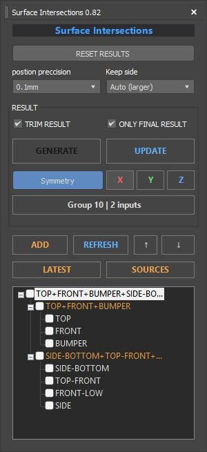



[View UI screenshot on Google Drive](https://drive.google.com/file/d/1W9_vFm42Qmj7CufiZB-xZYD6KZT-b82X/view)

# Surface-Intersections 1.02 — Development

**Current development release:** Project **1.02**, frontend UI **0.72**, backend **0.46** (2026-11-16). **User-confirmed stable baseline:** **0.91**. This README describes the current frontend; the older notes below are historical and may refer to layouts or actions that have since changed.

**v1.02 — Canonical INI filename:** All UI and docking settings use `Surface-Intersections.ini` in the tool root. On first launch, an existing `Surface-Intersections-UI.ini` is renamed in place if the canonical file does not already exist. No saved settings are discarded or overwritten; the INI filename is never version-suffixed.

**v1.01 — Dockable UI according to shared UI agents:** Surface Intersections is registered as a CUI dialog bar with `#(#cui_dock_vert, #cui_floatable, #cui_handles)`, so it can float or dock on the **left/right** of 3ds Max but not top/bottom. Newly created dialogs float by default. A saved `DockSide` value (`left`, `right`, `floating`) in the existing `Surface-Intersections.ini` restores the chosen side; floating position/size are preserved separately and not overwritten while docked. Existing legacy `SavedState=unregistered` records now register as dockable instead of reopening as permanently undockable. Registration is verified and CUI dialogs are unregistered before destruction/reload. The last screen-position correction remains in the existing tool-local helper, which is unchanged. Geometry, controls, SMART UPDATE, and 288px width are unchanged.

**v1.00 — SMART UPDATE (optional):** The new native **SMART UPDATE • MOUSE RELEASE** checkButton sits between RESULT and the TreeView and is off by default. With SMART enabled, a `NodeEventCallback mouseUp:true` queues node events until the mouse button is released; no geometry is generated while dragging. On release, actual world transforms of original source nodes and native group heads are compared row-by-row with saved Matrix3 copies. Only changed transforms mark their generated group ancestors pending; a one-shot UI timer schedules one rebuild of each affected top-level result. Nested dependencies and FINAL update through the existing `generateGroup` pipeline. Moves cancelled back to the original transform, scene selection, viewport navigation and visibility changes do not trigger an update. SMART state is saved in `Surface-Intersections.ini`; it unregisters its callback and timer when disabled or when the dialog closes. Manual GENERATE/UPDATE remains available. Non-mouse transforms, modifier/vertex editing, and event types not emitted by 3ds Max for a particular tool remain manual-update cases until verified separately. Real mouse-up delivery and geometry rebuild timing need an interactive test in 3ds Max, not just a synthetic test.

**v0.99 — Remove Result and scoped visibility:** Right-click any generated intersection result row and choose **Remove Result**. The operation deletes only that result's tool-owned mesh, curve, and stages, removes its operation wrapper from the TreeView, and promotes its child inputs into the same level. Original surfaces, native group heads and other generated results are preserved. Ancestor operations are marked pending for the next **UPDATE**. A confirmation prompt prevents accidental removal. Checkbox changes are now local to the clicked item, or all highlighted items when the clicked row is highlighted; **generated intersection result groups do not toggle nested objects**. The sole exception is a **closed native 3ds Max group** (`#scene_group`): its checkbox toggles the group head and all its listed members recursively. Open native groups do not cascade. No geometry is regenerated by visibility changes.

**TreeView selection and native groups (v0.97):** LMB highlights one row and selects its scene objects; CTRL+LMB adds or removes one highlighted row. There is no Shift-range or Ctrl-whole-branch highlighting. Selecting a generated-result parent selects its result node and every nested source/result object in the scene. Selecting a native scene group selects **only its nested members**, never its group-head helper. Multiple highlighted rows combine scene targets without duplication. Native group captions use brackets **only while the group is open in 3ds Max**, for example **`[SIDE]`**; closed groups display **`SIDE`**. Native group TreeView text is always **pink (RGB 240,118,177)**, independent of the helper wirecolor. Generated result rows retain their individual wirecolors. Group captions refresh on TreeView mouse entry. Checkbox visibility, geometry, and Generate/Update remain unchanged.

**Nested result assembly (v0.96):** The backend now keeps separate coincident-edge sheets as separate mesh elements, preventing a parent intersection from merging unrelated input surfaces. MCP verification in rover-285.max recorded a successful 57-polygon parent Generate/Update and 12 passing geometry/data checks. The current v0.97 UI selection change has not been runtime-verified.

**Group rows and visibility (v0.95):** Native 3ds Max scene-group heads are shown as **`[Group Name]`** in the TreeView, including nested group heads. Their text uses the group head helper's **actual scene wirecolor** (typically pink) and updates on tree refresh; the script does not change the helper's color. Generated result groups keep their existing unique result wirecolors and unbracketed names. Long group names retain their outer brackets when truncated and their full names in tooltips. Clicking the visibility checkbox of a **native group or generated result group** now always shows/hides the group and **all its nested members**, with or without Ctrl. When clicking a selected row, the same rule applies to every highlighted item; leaf sources only toggle themselves. Checkbox actions remain undoable, distinct from Ctrl+click row selection and independent of Generate/Update.

**Generate and visibility selection (v0.94):** With **no highlighted TreeView rows**, left-click **GENERATE** now wraps two or more top-level roots into the next result level, even when those roots are already generated intermediate result groups. Use **Ctrl+click** to select multiple groups in the tree: Ctrl+click still highlights the clicked group's entire hierarchy, but Generate counts only the highest selected root groups; descendants already covered by a selected parent are not treated as duplicate inputs. Only top-level roots can be wrapped. A single highlighted generated root does not implicitly regroup all results; clear the selection or explicitly Ctrl-select two roots. The independent right-click FINAL behavior from v0.93 remains available. **Checkbox visibility in v0.94:** That release used Ctrl for recursive group visibility. **v0.95 supersedes this:** every group checkbox click propagates to all members, even without Ctrl. Checkbox states remain independent of Generate and reflect scene visibility. No automatic geometry rebuild, backend change, or UI layout change.

**Generate FINAL (v0.93):** Right-click the **GENERATE** button to intersect **every top-level hierarchy root**, regardless of current TreeView highlights. Each generated result group contributes its **actual generated result mesh**, not a flattened copy of its original sources; native scene groups contribute their ordered original geometry as usual. The command builds one new parent result around all current roots, processing nested dependencies first and preserving existing group outputs. Loose top-level sources are included so no root is silently omitted. If a single top-level generated result already exists, right-click rebuilds that final result **in place** instead of wrapping it repeatedly. When only one native scene group exists with two or more surfaces, the command builds its result. Left-click **GENERATE**, **UPDATE**, visibility checkboxes, trim options and the 288 px layout are unchanged. A failed new parent restores the previous root structure and keeps the existing group results; the failure is logged. **v0.91 remains the confirmed stable baseline.**

**v0.91 stable:** The backend continuation-stub fix allows CABIN (TOP + FRONT + BUMPER) generation at the configured 0.1 mm precision. The recorded native 3ds Max 2026 test produced a visible 52-polygon result, preserved the original group member transforms, and retained the SIDE hierarchy result. The existing 11 geometry/data checks were recorded as passed. The user marked v0.91 stable on 2026-11-02; this designation does not imply new runtime tests in this documentation-only promotion.

**Ctrl+click hierarchy selection (v0.92):** Ctrl+clicking a generated result or native scene group selects every listed child and deeper descendant as well as the clicked group. This works with collapsed branches. The same objects are selected in the 3ds Max scene. Repeating Ctrl+click when the entire branch is selected removes all those rows from the selection; partial branch selection is completed by the next Ctrl+click. This is an additive tree-selection command and does not toggle viewport visibility or regenerate geometry. As of v0.94, Generate normalizes highlighted descendants under their selected parents without changing their actual TreeView selection; two selected top-level roots can be grouped. **v0.91 remains stable.**

**Generate selection fix (v0.90):** Scene selection now normalizes automatically highlighted descendants under their already selected parent group. In 3ds Max, selecting a native group can report both its head and its members; those are now represented by the highest selected hierarchy item, so GENERATE does not reject a valid top-level group merely because its child surfaces were also scene-selected. Intentional Ctrl/Shift mixed parent-and-child selections made directly in the TreeView retain the existing strict validation. No geometry operation, selection object, or group membership is changed by this fix.

Scene selection now synchronizes matching tree highlights while the dialog is open. Tree selection still selects scene objects; selection synchronization never regenerates geometry.

**v0.88 interface:** The hierarchy tree starts immediately below the RESULT section. Both action rows now sit below the tree, in order: **ADD / REFRESH / ↑ / ↓** and **LATEST / SOURCES**. The tree expands with window height.

**Current group visibility (v0.95):** Clicking a checkbox on a generated result group or native group head changes the state of that group and every nested member, **regardless of Ctrl**. If the clicked row is highlighted, each highlighted group subtree and every highlighted leaf is targeted, with scene nodes deduplicated. Clicking a source leaf affects only that leaf (or other explicitly highlighted items). Each visibility operation is undoable and changes no geometry or scene group membership. Checked states reflect effective viewport visibility, and hidden layers are not changed.

Run `Surface-Intersections.ms` in **3ds Max**. It loads the tool-local frontend, backend, and UI helpers. Geometry processing is **on demand**, not live. The existing dialog is 288 px wide, dockable left/right or floating, and vertically resizable so the hierarchy tree can expand.

## Registered floating dialog position — new in v0.89

The dialog's tool-local helper `Surface-Intersections-UI/SIRegisteredDialogOffset.ms` is forked from the separate user-confirmed v0.04 **Registered-Dialog-Position-Offset-Fix** backend. The fork preserves the approved pre-registration `[6,-2]` and post-unregistration `[-8,0]` corrections and is loaded before `DialogHost.ms`. The managed rollout restores registered/floating positions and sizes from the existing UI INI without saving intermediate registration movements; older saved positions are migrated. CUI continues to control docked edge positions. Screen/DPI-specific runtime acceptance remains to be tested on the Surface Intersections rollout.

## TreeView placement and scene visibility — new in v0.85

**LATEST** and **SOURCES** now sit in a fixed row **below** the vertically resizing TreeView. The 288 px RESULT controls and native Symmetry X/Y/Z buttons retain their locations. The ADD/REFRESH/UP/DOWN row moved below the tree in v0.88.

Each TreeView checkbox now mirrors the **viewport visibility of its referenced scene object**: checked = visible, unchecked = hidden. This applies to source surfaces, native group heads and generated result objects. Click to hide/unhide the referenced node; when clicking a highlighted row, the same state applies to all highlighted object rows. Starting in v0.95, group checkbox clicks propagate to all nested members **without requiring Ctrl**. The action is undoable and does not rebuild geometry or alter group membership. A hidden layer, category filter or frozen-object display setting can keep a node invisible even after its local hidden flag is cleared; the checkbox remains unchecked to reflect that effective visibility. The tool does **not** unhide unrelated layers automatically. The display refreshes when tree rows are rebuilt, on scene hide/unhide notifications, and when the mouse re-enters the tree.

**Important workflow change:** Checkboxes no longer select inputs for Generate/Update. Highlight tree rows with normal/Ctrl/Shift clicks; Generate uses highlighted top-level inputs, and Update uses highlighted result groups (or all root results when nothing is highlighted). With no highlight, the existing implicit all-roots Generate behavior remains available where applicable.

## Native X/Y/Z Symmetry buttons — updated in v0.84

The three X/Y/Z axis toggles use native MaxScript `checkButton` controls rather than .NET CheckBox controls. Their positions (148/192/236, y=218), sizes (40 x 28), independent axis states, bit-mask persistence, and result-targeting semantics are unchanged. Checked axes use red/green/blue native highlight colors. Native control text uses the 3ds Max theme instead of the previous custom .NET font colors. The v0.82 screenshot above is a layout reference and shows the former .NET axis controls.

## Native 3ds Max scene groups — new in v0.83

A native **Group** created in 3ds Max uses a **group head helper**. Selecting that head or one of its members and clicking **ADD** imports the whole native group as a single expandable branch in the Surface Intersections hierarchy. Nested native groups retain their member-tree structure. The helper is never passed to the mesh engine: original geometric children are expanded in their native order for intersection processing.

- **GENERATE** can create a result from one imported native group containing at least two surface objects, or combine it with other top-level inputs. The generated result retains a child **scene group** row, with original members listed beneath it.
- After successful generation, the original group head is **linked as a child of the visible result object** in the 3ds Max scene, without destroying the native group or its member links. The TreeView reflects the same hierarchy.
- **UPDATE** rescans the group head's direct members (including nested native group heads) before rebuilding. New or detached source surfaces are reflected on the next explicit update; no live background generation occurs.
- **RESET RESULTS** restores source-group parenting before deleting generated result objects; original group helpers and member geometry are preserved.
- Scene group heads are reference containers, not independently evaluated intersection surfaces. When fewer than two usable member surfaces are available for an operation, generation fails with an explicit error instead of snapshotting the helper node.

Test in a **disposable scene** after loading the tool: `fileIn @"C:\path\to\Surface-Intersections-Scene-Group-Test.ms"` then `siSceneGroupTestRun()`. This test creates native groups and geometry and must not be run in an unsaved working scene.

## Current frontend — interface guide

### Title and global settings

| Control | What it does |
| --- | --- |
| **Surface Intersections** (blue title button) | Restarts/reloads the tool. |
| **RESET RESULTS** | After confirmation, deletes generated results belonging to this hierarchy while retaining original source surfaces. |
| **postion preccision** | Sets the computational position-matching precision: `1mm`, `0.1mm`, or `0.01mm`; the current default is **0.1mm**. This is not a command to snap source vertices. |
| **Keep side** | Sets the kept side for the focused hierarchy item: `Auto (larger)`, `Negative normal`, `Positive normal`, or `No clipping`. |

### RESULT section

| Control | What it does |
| --- | --- |
| **TRIM RESULT** | Enables the trim-result option used when generating or updating. |
| **ONLY FINAL RESULT** | Hides intermediate child results but keeps them available for subsequent updates. |
| **GENERATE (LMB)** | Creates the next result level from at least two highlighted top-level inputs, including Ctrl-selected generated groups. When **nothing is highlighted**, combines **all top-level roots**, even existing mid-level results. With one highlighted root, the older all-roots fallback applies only if no top-level result group exists. A single native scene group with two or more sources may be generated directly. |
| **GENERATE (RMB)** | Generates one **FINAL** parent intersection from **all** top-level hierarchy inputs, using group result meshes as child inputs. With a single existing result root, rebuilds it in place. Independent of TreeView selection. |
| **UPDATE** | Rebuilds highlighted result groups and their dependencies; when no rows are selected or checked, updates all top-level result groups. A single explicitly targeted group can also accept selected original geometry during Update. |
| **Symmetry** and **X / Y / Z** | Apply tool-owned Symmetry controls to selected top-level result groups, or all top-level results when none are highlighted. |
| **Group N \| M inputs** | Displays the focused group's hierarchy ID and input count. Left-click selects its scene object; right-click loads a saved hierarchy from the selected scene result; Ctrl+click starts another hierarchy while retaining existing scene outputs. |

### Sources and hierarchy TreeView

| Control | What it does |
| --- | --- |
| **ADD** | Appends selected **original scene geometry** as top-level source rows; generated output objects are excluded. |
| **REFRESH** | Replaces loose top-level source rows from the current scene selection while preserving existing result groups. |
| **↑ / ↓** | Moves the focused row up/down among its siblings; hold **Ctrl** to move it to the beginning/end. This changes source processing order. |
| **LATEST** | Selects the most recently generated result object. Located below the TreeView. |
| **SOURCES** | Selects all original source objects represented in the hierarchy. Located below the TreeView. |
| **Tree rows** | Expand/collapse nested groups. Normal click selects one row; **Ctrl+click** selects/toggles complete group branches or individual leaves, retaining multiple selected groups. Generate uses the highest selected **top-level** groups and ignores their already-selected descendants. Shift-click retains visible-range selection. Result labels retain their result wirecolors; native scene-group labels use **`[Group Name]`** and the group head helper’s actual (often pink) wirecolor. `*` means pending, and hover shows full names. |
| **Row checkboxes** | Checked = visible. Clicking a group checkbox toggles that group and all descendants. Clicking a leaf toggles the leaf (or explicitly highlighted items). Ctrl is no longer needed for group propagation; these actions never Generate. |
| **Right-click a source row → Remove** | Removes the source row(s) from the hierarchy, not the original scene objects. If the clicked source is among multiple highlighted sources, removes the highlighted source rows as a batch. |
| **Right-click a result group → Add Selection** | Adds currently selected original scene geometry to that specific group. Press **UPDATE** to regenerate the group from its updated inputs. |

### Typical workflow

1. Select original surface geometry in the scene and click **ADD** to populate the hierarchy.
2. Highlight two or more top-level inputs (Ctrl supports multiple group selections) and click **GENERATE**. Alternatively, clear the TreeView selection and click **GENERATE** to combine all current root inputs and mid-results into the next level.
3. To extend a specific group, select the additional geometry in the viewport, right-click that group's result row and choose **Add Selection**, then target the group and click **UPDATE**.
4. Use **↑ / ↓** to change source priority, **TRIM RESULT** / **Keep side** to configure trimming, and **ONLY FINAL RESULT** to reduce intermediate clutter. Rebuild using **UPDATE**.
5. Use **RESET RESULTS** when you want to clear generated hierarchy outputs but retain the original geometry.

**v0.94 model-only regression:** After loading the updated UI in 3ds Max, run `fileIn (si_ui_directory + "test\\Surface-Intersections-Generate-Visibility-Test.ms")`, followed by `siGenerateVisibility094TestRun()`. This test creates or modifies no scene nodes. Real mouse-click and result-generation acceptance must be tested in a disposable scene.

**Source files:** [`Surface-Intersections.ms`](./Surface-Intersections.ms) (entry), [`Surface-Intersections-UI.ms`](./Surface-Intersections-UI.ms) (frontend), [`Surface-Intersections-FN.ms`](./Surface-Intersections-FN.ms) (processing). See [`design.md`](./design.md) for behavior details and unresolved geometry limitations, and [`changes.md`](./changes.md) for version history.

---

## Earlier release notes

# Surface-Intersections 0.67 — Development (Symmetry axes)

Latest source build 0.67 (backend 0.35, UI 0.43). **User-confirmed stable baseline remains 0.66.**

The tool adds a dedicated Symmetry row with X/Y/Z toggles. Highlight one or several top-level generated results to target those; with no tree highlight, all generated top-level results are targeted. Each enabled axis adds a distinct native Symmetry modifier (X/Y/Z = 0/1/2). The tool removes only its own marked modifiers from child results after successful generation and temporarily disables them for intersection evaluation. Artist-created modifiers are preserved; enabled artist Symmetry on child result must be disabled before parent intersection.

Load the canonical `Surface-Intersections.ms`. With its dialog open, load `test/Surface-Intersections-Symmetry-Axes-Test.ms` and call `siSymmetryAxesTestRun()` for a read-only check. Optional `siSymmetryRootTestRun 8` checks owned modifiers on root group 8. Runtime tests in a scratch scene are still needed.

# Surface-Intersections 0.66 — Stable

**User-confirmed stable baseline: v0.66 (2026-10-31).** Backend 0.34; UI 0.42. Preserve this version as the reference for hierarchy grouping, on-demand generation and TOP–FRONT border extension at 0.01mm precision. Automatic endpoint Slice remains disabled; existing native modifier stacks are retained.

## Previous release 0.63 — Tree selection and result wirecolors

Click a TreeView row to select that exact scene object; Ctrl-click toggles multiple rows and Shift-click selects a visible range. Result labels use their result objects' unique persisted wirecolors. Generate accepts checked roots first, or highlighted top-level inputs when no grouping checks are set. Add and Refresh remain 72 x 24 px.

Load the canonical `Surface-Intersections.ms` entry file. With the tool open, run `test/Surface-Intersections-Tree-Selection-Colors-Test.ms`, then call `siTreeSelectionColorsTestRun()` for a read-only scene-object check (selection is restored). That release used backend 0.32; it is retained here as historical context.

# Surface-Intersections

Project **0.66** — explicit trim groups in one .NET TreeView.

Run `Surface-Intersections.ms` in 3ds Max. The entry loads the tool-local backend, UI and helpers.

1. Select original surface objects and press **Add**.
2. Select three top-level sources (Ctrl/Shift), or check their boxes, and press **Generate Group**. Expand its result to inspect the three inputs.
3. Select the other four sources, or check their boxes, and generate a second group.
4. Select both top-level result groups, or check their boxes, and generate the parent intersection.

Select a result row and press **Update Selected Group** to regenerate that operation and its dependencies. Nothing regenerates live. Double-click a row to select its scene object. **Up / Down** changes sibling processing order; Ctrl moves to the beginning/end. An asterisk marks pending groups.

**Remove** dissolves a top-level group or removes a loose source row, retaining scene objects. **Refresh** replaces loose source rows from scene selection while retaining result groups. **ONLY FINAL RESULT** hides child results below each root; it retains them for future updates. **Reset Hierarchy Results** deletes this forest's outputs and preserves original surfaces.

The hierarchy lives on a hidden catalog saved in the Max scene. Right-click the result button to load a selected saved hierarchy result. Ctrl-click the button to begin another forest while retaining the previous outputs. Each group has its own trim options and precision. Automatic endpoint Slice remains disabled; cuts extend to borders.

Load `test/Surface-Intersections-Hierarchy-Test.ms` for scene-safe model checks. Optional native/UI checks create temporary fixtures and remove only their own nodes:

```maxscript
siHierarchyModelTestRun()
siHierarchyNativeTestRun()
siHierarchyUiTestRun()
siHierarchyDeletedControllerTestRun()
```

See `design.md` for the current behavior contract, verification scope and known geometry limitations. v0.52 remains the last user-confirmed stable version.


